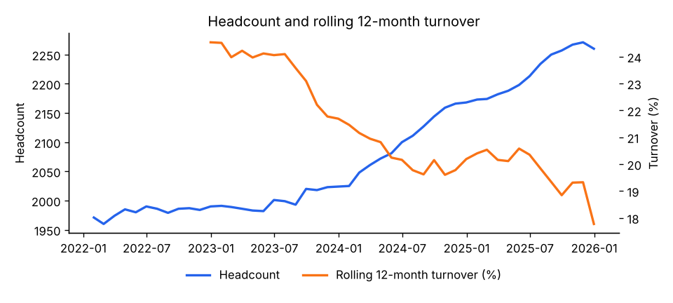
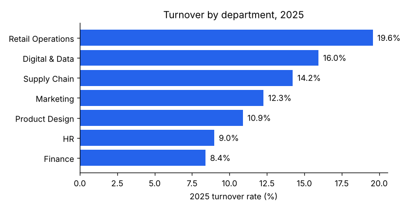
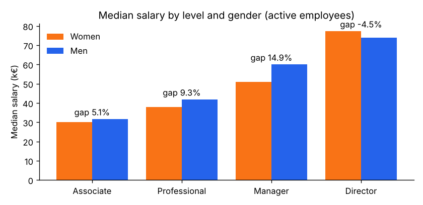
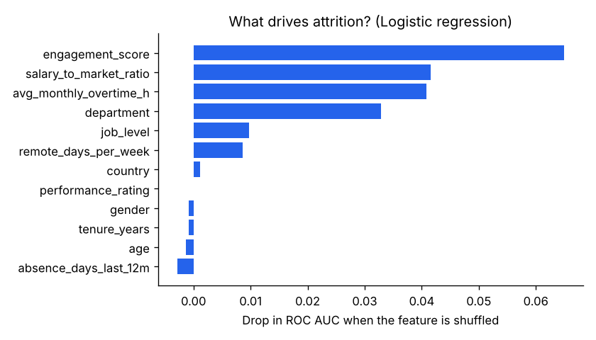

# HR Analytics: turnover, equal pay and attrition risk

**Business question:** a 4,000-employee retail group wants to know where it is losing people, whether pay is fair between women and men at the same level, and which employees are most at risk of leaving next year so HR business partners can act early.

> All data is **synthetic**, generated by `src/generate_data.py` for a fictional company. It mimics a standard HRIS export (Workday-style): hire/leave dates, organisation, pay, engagement survey, overtime and absences.

## What this project shows

| Skill | Where |
|---|---|
| HR KPI design (headcount, turnover, absenteeism, pay gap) | `src/analysis.py`, `sql/hr_kpis.sql` |
| SQL for a lakehouse (Databricks / Spark SQL) | `sql/hr_kpis.sql` |
| Power BI semantic layer (DAX measures) | `powerbi/measures.dax` |
| Predictive modelling and explainability (scikit-learn, permutation importance) | `src/analysis.py` |
| Turning numbers into recommendations | this README |

## Key results



- 2025 turnover: **17.8 %**. Retail Operations (19.6 %) loses people more than twice as fast as Finance (8.4 %).



- Raw median pay gap at the same level: 5.1 % (Associate), 9.3 % (Professional), 14.9 % (Manager). The gap is not adjusted for department, and the Director group is small (92 people), so the next step would be a regression controlling for department, country and tenure, as required for a proper equal-pay audit.



- **Attrition model:** using only data available on 1 January 2025, a logistic regression ranks employees by leaving risk (ROC AUC 0.68 on a held-out test set). The 20 % highest-risk employees account for **41 %** of the people who actually left during the year, so HR can focus retention effort where it matters.



- The main drivers are **engagement score, pay versus market, and overtime**, followed by department. All three are things the company can act on.

## Recommendations (for the fictional client)

1. Review salaries that sit well below the market benchmark, starting with Retail Operations.
2. Monitor overtime monthly in the HR dashboard and alert managers above a threshold.
3. Share a quarterly risk list with HR business partners, with the main reasons for each person, rather than a single score.
4. Run an adjusted pay-gap analysis before drawing conclusions on equal pay.

## Run it

```bash
pip install -r ../requirements.txt
python src/generate_data.py   # creates data/employees.csv
python src/analysis.py        # creates figures/ and results.md
```

## Limits

Synthetic data with simple, known relationships. On real data the model would need: a time-based validation (train on 2023, test on 2024), checks for bias across gender and age before any use, and a GDPR-compliant process (aggregated reporting, no automated individual decisions).
