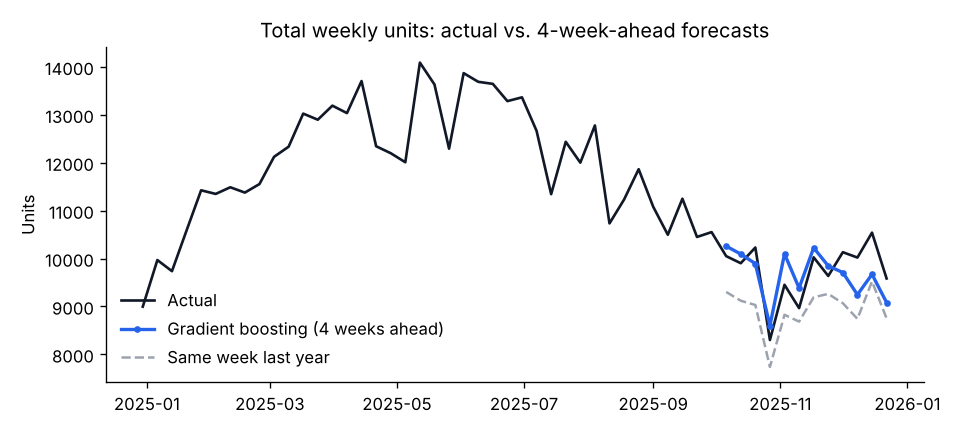
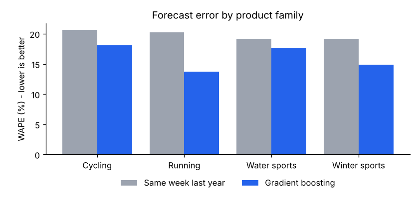

# Demand forecasting for a sports retailer

**Business question:** a 12-store sports retailer orders stock 4 weeks in advance. Store managers currently copy last year's sales, which leaves shelves empty when the business grows and over-stocks when it doesn't. Can a model do better, and by how much?

> All data is **synthetic**, generated by `src/generate_data.py`: 3 years of daily sales for 12 stores and 4 product families (Running, Cycling, Water sports, Winter sports), with growth, weekly and yearly seasonality, promotions and French public holidays.

## Approach

1. Aggregate daily sales to **weekly units per store and family** (the level at which orders are placed).
2. Build features available **4 weeks before** the target week only (no data leakage): lagged sales, 8- and 26-week rolling means, sales 52 weeks earlier, calendar, planned promotions and holidays.
3. Compare three methods on a **rolling-origin backtest** (12 cut-off dates, 4 weeks ahead each time), the way the model would actually be used:
   - last week's sales (naive),
   - same week last year (the current practice),
   - gradient boosting with a Poisson loss (scikit-learn `HistGradientBoostingRegressor`).
4. Measure **WAPE** (weighted absolute percentage error, the usual retail metric) and **bias** (systematic over- or under-forecasting).

## Results

| Method | WAPE | Bias |
|---|---|---|
| Last week (naive) | 23.6 % | +1.3 % |
| Same week last year (current practice) | 19.9 % | −8.1 % |
| **Gradient boosting** | **15.5 %** | **−0.4 %** |



- The model cuts forecast error by about **22 %** compared with the current practice.
- Above all it removes the **−8 % bias** of "same week last year", which systematically under-orders because the stores are growing. That bias is what causes stock-outs.



- Cycling and Water sports are harder to forecast (strong seasonality, more promotions). They would be the first candidates for safety stock rules or a dedicated model.

## Next steps on real data

- Add weather, local events and price, and test product-level forecasts.
- Turn forecasts into order quantities with a service-level target (safety stock).
- Schedule the pipeline (Databricks job or Airflow) and monitor error drift in a dashboard.

## Run it

```bash
pip install -r ../requirements.txt
python src/generate_data.py   # creates data/sales.csv (~52k rows)
python src/forecast.py        # backtest, figures/ and results.md
```
