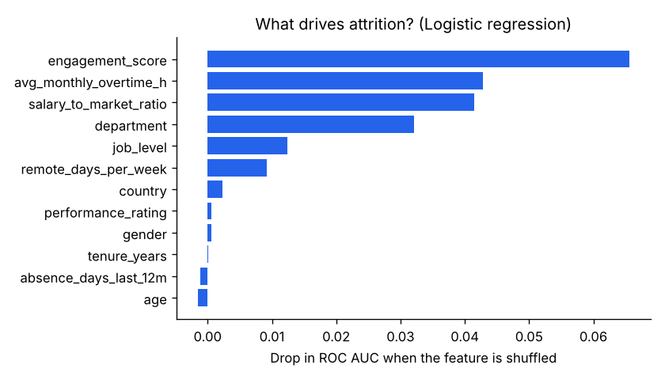
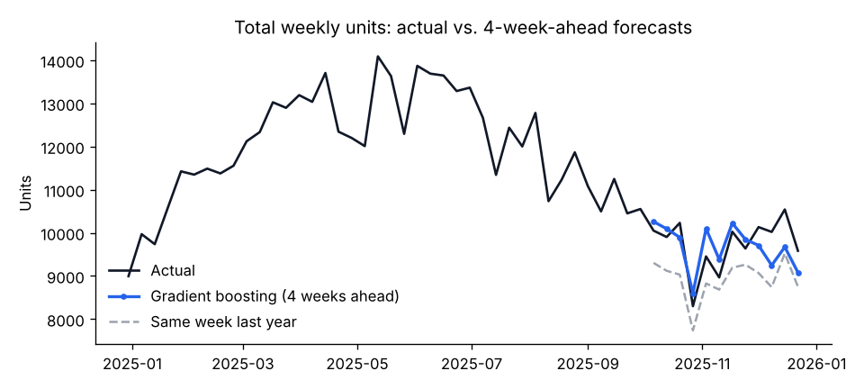

# Elysée Mugabire: Data & AI portfolio

Data scientist and BI engineer (ESIEE Paris engineering degree in Data Science & AI, Master's in Data Analysis from IAE Paris-Est, 2026). I build data products that answer a business question end to end: from raw data to a model or a dashboard, and a recommendation someone can act on.

**Background:** Data & BI Engineer apprentice in corporate HR at Decathlon (Databricks, Tableau, industrialised reporting, Workday custom reports); data scientist intern in Taiwan (ML forecasting models).

**Stack:** Python (pandas, scikit-learn, Keras), SQL, Spark / Databricks, R, Power BI, Tableau, Streamlit, Plotly, Docker, Kubernetes, CI/CD, Workday reporting, LLM APIs (Claude).

**Languages:** French (native), English (professional, TOEIC 825).

## 🚀 Interactive app

All four projects are presented in an **interactive Streamlit app**: filterable HR dashboard, what-if attrition simulator, forecast explorer by store and product family, a live invoice extraction demo, and a multi-agent HR team you can question.

**👉 Live demo: _add your Streamlit Community Cloud link here_**

Run it locally:

```bash
pip install -r requirements.txt
streamlit run Home.py
```

> All datasets in this repository are **synthetic** and generated by the code itself, so that the projects can be shared publicly without any confidential data.

## Projects

| # | Project | Business question | Highlights |
|---|---|---|---|
| 01 | [HR analytics: turnover, equal pay and attrition risk](01-hr-analytics/) | Where are we losing people, is pay fair, who is likely to leave next? | HR KPIs, SQL for Databricks, Power BI DAX measures, attrition model with explainability |
| 02 | [Demand forecasting for a sports retailer](02-sales-forecasting/) | How much should each store order 4 weeks ahead? | Rolling backtest, no data leakage, forecast error cut by ~22 % vs. current practice, bias removed |
| 03 | [AI invoice extraction with Claude](03-ai-invoice-extraction/) | Can we stop retyping supplier invoices? | LLM structured output, business-rule validation, tests, Docker, GitHub Actions CI |
| 04 | [HR agent team (multi-agent)](04-hr-multi-agent/) | Can an AI team answer an HR director's question in a minute? | Coordinator + 3 specialist agents, tool use, parallel sub-agents, privacy-safe tools, tests with a fake client |

<p>
  
  
</p>

## What I can help with

- **Dashboards and reporting** (Power BI, Tableau) built on clean, automated data pipelines.
- **HR data and people analytics:** workforce KPIs, turnover and absenteeism, equal-pay analysis, Workday reports.
- **Forecasting and predictive models** that are tested the way they will be used.
- **AI automation:** turning documents and repetitive tasks into structured data with LLMs, with safeguards.
- **AI agents:** multi-agent assistants that answer business questions from your own data through controlled tools.

## Run the projects

```bash
git clone https://github.com/Elysee59/data-portfolio.git
cd data-portfolio
pip install -r requirements.txt
```

Each project folder has its own README with the commands to run it.

## Contact

[LinkedIn](https://www.linkedin.com/) · open to remote freelance missions and full-time roles.
